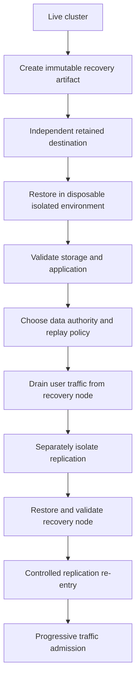

import Tabs from '@theme/Tabs';
import TabItem from '@theme/TabItem';

Replication supports availability, but also propagates destructive writes, schema errors, and application corruption to peers. You need backups to recover an earlier state.

This guide covers choosing a backup mechanism, keeping an independent copy, and testing that you can restore service within your recovery targets.

## What You Will Learn

- How to choose a backup mechanism for your storage engine and recovery targets
- How to copy and retain backups independently of the source node
- What `verify_backup` does and does not check
- Which databases can be restored with the server running, and which cannot
- Why restoring a database to undo a code bug is usually the wrong move

## Prerequisites

- A cluster with a `super_user` credential, and CLI access to at least one node
- Knowledge of your storage engine per database, from your service boundary inventory in [How Harper Runs in Production](./how-harper-runs-in-production.mdx)
- [Operating Replication](./operating-replication.mdx), because a restore in a replicated cluster is a replication event as much as a storage one
- A non-production database you are willing to destroy

## Decide before you choose a command

Record these decisions in your reliability plan:

1. **Which failures must you survive?** Include node or storage loss, bad deployments, destructive operations, application corruption, regional outages, and compromised credentials. Choose a recovery mechanism for each.
2. **What are the recovery targets?** State acceptable data loss per database and time to restore each affected journey. Use those targets to set backup frequency and test the restore procedure.
3. **What granularity do you need?** Managed backups restore whole databases. To recover selected tables or records, restore into an isolated environment and plan a separate data repair. LMDB snapshot options differ; see [backup operations](/reference/v5/backups/operations#get_backup).
4. **Where must copies live?** Choose independent storage locations, retention periods, and access controls.
5. **Who may authorize and execute a restore?** Name the approver and operator, and record their actions. An in-place restore replaces current data.

## Know which mechanism you have

| Mechanism                                             | Engines                                 | What it is                                                                                                             |
| ----------------------------------------------------- | --------------------------------------- | ---------------------------------------------------------------------------------------------------------------------- |
| **Managed backups** <VersionBadge version="v5.2.0" /> | <EngineBadge engines="RocksDB" />       | Incremental, verifiable backups in a server-side repository under `storage.backupPath`                                 |
| **Snapshot download**                                 | <EngineBadge engines="RocksDB, LMDB" /> | [`get_backup`](/reference/v5/backups/operations#get_backup) streams a snapshot over HTTP, with no server-side artifact |

RocksDB managed backups and snapshot downloads include all tables, the transaction log, and file-backed blobs unless you request `exclude_blobs`. Restoring that complete backup preserves its `read_audit_log` history.

LMDB `get_backup` streams the `.mdb` file and does not include external blob files. Table-filtered downloads include the audit store only with `include_audit: true`. If an LMDB database uses file-backed blobs, use a coordinated filesystem or volume backup of the database and every blob root with Harper stopped. An `.mdb` download alone cannot recover those blobs after the source node is lost.

:::warning
Two limitations to check against your own deployment now rather than later:

- **Managed backups require RocksDB.** For LMDB databases your options are `get_backup` or volume snapshots.
- **One storage root per database.** Backup is rejected when a database's tables resolve to multiple storage roots. Custom database or table paths are valid if all tables still resolve to one root. Use a separate backup strategy for databases split across roots.

:::

## Create and retain managed backups

<Tabs>
  <TabItem value="api" label="Operations API">

```json
{
	"operation": "create_backup",
	"database": "data"
}
```

Through a running server this returns a `job_id` immediately. Poll [`get_job`](/reference/v5/operations-api/operations#get_job) for the outcome, which includes the new `backup_id`, `size`, and `timestamp`. Treat the job result as the completion signal, not the original response.

  </TabItem>
  <TabItem value="cli" label="CLI">

```bash
harper create_backup database=data
harper list_backups database=data
harper purge_backups database=data keep_count=7
```

Every backup operation runs from the CLI under the same name. With the server running the CLI forwards to the server; with it stopped the command operates directly on the files.

`get_backup` requires a running server. Document how to copy the managed backup repository or take a volume snapshot if the server cannot start.

  </TabItem>
</Tabs>

Backups of the same database share unchanged RocksDB data files, so the first one copies everything and later ones copy only what changed. Shared files are reference-counted, so deleting a backup removes only files no remaining backup references.

:::warning
Each backup is a full logical snapshot, but its disk cost depends on file sharing:

- RocksDB backups share unchanged data files within the same repository.
- The transaction-log snapshot is copied for each backup. Include it when measuring repository growth.
- Blob snapshots use hard links when the source and destination filesystem support them. Otherwise, they copy the files. Use `exclude_blobs: true` only if your recovery procedure can recover those blobs separately.
- <VersionBadge version="v5.3.0" /> Restoring a backup created with `exclude_blobs: true` requires `allow_engine_only:
  true`, even into a new database. This explicitly accepts the risk of records pointing at missing or unrelated blob
  files. Include separate blob recovery and validation in the drill; do not add the flag just to bypass the safety
  check.
- An export that does not preserve sharing materializes those shared or linked files as separate copies. Budget for the full exported size.

Measure physical repository growth over several backups with your retention policy and filesystem. Do not assume that a full logical snapshot consumes its full logical size, or that all snapshot files are hard-linked.
:::

Do not use `list_backups` sizes for capacity planning. The `size` and `file_count` fields come from the RocksDB backup engine and exclude the transaction-log and blob snapshots, so each entry undercounts, while the shared files between entries mean summing them overcounts. Measure the repository directory instead.

## Get a copy off the node

Keep a recoverable copy outside the source node's failure and administrative boundaries. Separate credentials and retention controls should prevent a compromised node or backup writer from deleting that copy or weakening its retention policy.

**Managed backups live on the node that created them.** The repository is a local directory, and RocksDB shares files across backup IDs, so **a backup ID is not a self-contained folder.** Two consequences:

- A disaster-recovery copy has to take the entire per-database repository, `<backupPath>/<database>`, not an individual backup.
- It has to do that while no backup operation is running, or from an atomic filesystem snapshot. A live recursive copy can race `create_backup`, `delete_backup`, or `purge_backups` and produce an unrestorable copy.

To take a fresh snapshot directly to another machine, run:

```bash
# Pull a snapshot of the current state from a running node
harper get_backup database=data out=./data-$(date +%Y%m%dT%H%M%S).tar.gz

# Or pull a snapshot of another node, writing it to a file here
harper get_backup database=data target=https://operations.node-2.example.com out=./data.tar.gz
```

`target=` only changes which node the snapshot is read from. It writes a file and nothing else: it does not restore, import, or clone that node's database onto the local one. Turning the file into a live database is a separate, deliberate restore step, performed with Harper stopped.

Note also that `get_backup` always streams the current state. It cannot download a historical managed backup, so it is a way to take a fresh off-host copy, not a way to export your retention history.

Give each exported recovery artifact a unique, immutable identity. Include a manifest with its database, Harper version, backup timestamp, included files, blob roots, and checksums. After upload, read back the destination metadata and confirm the expected identity, size, encryption, versioning, and retention settings where supported. Checksum verification must cover the copy at the destination.

## Verification is not optional

```json
{
	"operation": "verify_backup",
	"database": "data",
	"backup_id": 1,
	"verify_checksum": true
}
```

`verify_backup` checks the RocksDB file sizes, their checksums when `verify_checksum` is `true`, which is slower, and the framing of the transaction-log snapshot, which is always checked.

**Blob contents are not verified.** Verification checks that a required blob snapshot is present, but does not check individual blob files for size, checksum, or readability. Validate those separately during restore testing.

Verification checks the backup's structure. A restore test checks whether it can recover your application.

## Know your restore constraints before the incident

An in-place RocksDB restore requires the database to be closed:

| Database                                       | Online restore, server running       | Offline restore, server stopped |
| ---------------------------------------------- | ------------------------------------ | ------------------------------- |
| A user database no loaded component holds open | Yes, restored in place               | Yes                             |
| A user database a loaded component holds open  | No, the job ends in `ERROR`          | Yes                             |
| The `system` database                          | No, rejected before a job is created | Yes                             |

Because the restore runs as a background job, a component holding the database open does not fail your request. It fails inside the job, so you find out from `get_job` rather than from the response. Harper does not track which component uses which database, so it cannot selectively stop one.

:::tip
Safe mode skips user applications and components while keeping the built-in root component, database, Operations API, and HTTP server available:

```bash
HARPER_SAFE_MODE=1 harper run
```

This can release user database handles held by application components so an online restore can proceed. It also lets you inspect or remove a component that prevents normal startup. Keep user traffic and replication isolated during recovery. Safe mode does not remove the offline requirement for restoring `system`. See [safe mode](/reference/v5/configuration/overview#harper_safe_mode).
:::

Also include these constraints in the restore procedure:

- **`target_database` requires the server stopped.** Restoring into a separate database rather than overwriting the source is CLI-only with Harper down. The target must not already exist or must be an empty directory.
- **An interrupted restore leaves the database unloadable.** On a crash or power loss mid-restore, Harper marks the database as incompletely restored and refuses to load it on the next start. Recover by rerunning `restore_backup` for the same database and `backup_id`. Do not try to load or hand-repair the directory.

## Restoring in a replicated cluster

A restored node may be behind peers that have continued accepting writes. Peers can replay newer writes, including the destructive mutations you intended to undo. Restoring one node does not make its backup authoritative; choose which data to preserve or repair and rehearse the re-entry policy before reconnecting it.



For an in-place recovery:

1. Take the node out of rotation with the availability flag, per [Health Checks and Traffic Admission](./health-checks-and-traffic-admission.mdx). Never restore a node that is serving traffic.
2. **Isolate replication separately.** For example, use a network policy that blocks peer replication in both directions and closes existing peer connections. Keep it effective across restarts, and verify that transactions cannot cross the boundary. Removing a node from the load balancer or setting `"replicated": false` on one operation does not isolate replication.
3. Confirm the data authority and replay policy: which writes to preserve, repair, or reapply, and how peers will converge.
4. Perform the restore, online or offline according to the table above.
5. Verify data expectations locally before any peer sees the node.
6. Reconnect replication under the policy you proved in an isolated multi-node drill. If that policy would reintroduce corruption from a peer, keep the affected peers isolated and reconcile their data first. Verify convergence, then complete the traffic-admission checks before restoring traffic.

:::danger
**Draining traffic does not stop replication.** A drained node continues exchanging transactions with peers. An offline restore stops that exchange while Harper is down, but configured routes can reconnect as soon as it starts. Keep replication isolated until validation is complete and you are ready to execute the re-entry policy.
:::

## What backups cannot fix

If a release changed the meaning of persisted data, restoring the database is usually the wrong response. A restore rolls back every write in the window, including all the correct ones from the same period, so you can violate your recovery point objective in the course of fixing a code bug.

For that failure class, define forward repair instead: a targeted correction, or a replay from the transaction log, that fixes the affected records and leaves the rest alone. Decide which of your failure classes get restore and which get forward repair while you are calm, and record the decision. See [Safe Deployments and Rollback](./safe-deployments-and-rollback.mdx) for how this interacts with release reversal.

## Test the backup program

Test the copy you would actually use after losing a node, including its destination controls:

1. Create a backup and verify it with `verify_checksum: true`. For other mechanisms, use the corresponding integrity checks.
2. Export it using the procedure above. Record the immutable artifact ID, backup timestamp, manifest, and checksums. Read back destination metadata and check that the backup writer cannot weaken retention.
3. Restore the destination copy into a disposable environment with a compatible Harper version. Isolate it from production traffic, replication, and application side effects.
4. Validate the expected databases, tables, record counts, blob contents, and business invariants. Run the critical user journeys against the restored application.
5. Rehearse the failure-to-recovery procedure on a non-production cluster. Measure elapsed time from the simulated failure, including detection, transfer, restore, validation, and traffic admission. Compare recovered writes against the failure time to measure actual data loss.
6. Record the artifact ID, backup time, validation results, operator, approver, and achieved RPO and RTO. Rehearse an offline `system` restore separately.

Use these results in [Engineering RPO, RTO, and Uptime](./engineering-rpo-rto-and-uptime.mdx). If recovery misses a target, improve the procedure or revise the commitment.

Monitor the age of the newest recovery point that has passed the required destination and recovery checks. A successful backup job alone does not establish a usable recovery point.

For records requiring long-term preservation, keep a separate export in a documented format that can be read independently of Harper. Operational backups serve disaster recovery; preservation exports also need to remain usable after the original software is retired. Choose cadence, storage provider, and any physical-media process for your own environment.

## Operational notes

- **Retention is a policy, not a side effect of disk space.** Use `purge_backups` with an explicit `keep_count` that matches a written retention decision.
- **Backup operations are `super_user` through the server, and filesystem permissions offline.** An operator with shell access on a node can restore without an API credential, so protect the host accordingly.
- **Schedule backups per database, matched to that database's recovery point.** A single cluster-wide cadence overspends on some databases and underspends on the ones that matter.
- **Alert on job failure and recovery-point age.** Track the newest fully verified recovery point and alert before its age exceeds your RPO.
- **Record the storage engine per database in your inventory** and re-check after migrations, since your entire mechanism choice depends on it.

## Readiness checklist

- [ ] Failure classes enumerated, with the mechanism that addresses each
- [ ] Database recovery points and journey recovery times recorded using the [objective definitions](./engineering-rpo-rto-and-uptime.mdx#state-objectives-for-each-journey-and-its-data)
- [ ] Storage engine confirmed per database, and the mechanism chosen accordingly
- [ ] No database in scope has tables spanning more than one storage root, or the exclusion is known and accepted
- [ ] Backup cadence matches the stated recovery point per database
- [ ] Repository growth measured across successive backups, including transaction-log copies and blob hard-link behavior
- [ ] Export capacity accounts for full copies where file sharing is not preserved
- [ ] An off-host copy exists across separate failure and administrative boundaries
- [ ] Artifact identities, manifests, checksums, and destination metadata verified
- [ ] Backup writer cannot weaken retention
- [ ] Managed repository copies take the whole `<backupPath>/<database>` directory, quiesced or from an atomic snapshot
- [ ] `verify_backup` runs on a schedule, with `verify_checksum` at least periodically
- [ ] Blob contents understood to be unchecked by `verify_backup`, which confirms only that the blob snapshot is present
- [ ] Restore constraints documented for user databases, component-held databases, and `system`
- [ ] Restore authority named, and restore execution logged
- [ ] Restore procedure isolates the node from replication, not just from user traffic, since the availability flag does not stop peer exchange
- [ ] Safe mode known as the way to restore a database a component holds open, and to reach a node a broken component stopped
- [ ] Destination copy restored in a disposable, isolated environment with a compatible Harper version
- [ ] Inventory, counts, blobs, business invariants, and critical journeys validated
- [ ] Artifact ID, timestamp, validation results, operator, approver, achieved RPO, and achieved RTO recorded
- [ ] Alerts use the newest fully verified recovery point
- [ ] `system` database restore rehearsed offline
- [ ] Forward repair defined for corruption caused by application code
- [ ] Separate preservation export defined where long-term access is required

## Additional Resources

- [Backups overview](/reference/v5/backups/overview) for how managed backups work, the full limitation list, and manual restore examples
- [Backup operations](/reference/v5/backups/operations) for every parameter of `create_backup`, `list_backups`, `verify_backup`, `delete_backup`, `purge_backups`, `restore_backup`, and `get_backup`
- [Storage configuration](/reference/v5/configuration/options#storage) for `storage.backupPath`, `storage.path`, and `storage.blobPaths`
- [Jobs](/reference/v5/operations-api/operations#jobs) and [`get_job`](/reference/v5/operations-api/operations#get_job) for tracking long-running backup operations
- [CLI operations](/reference/v5/cli/operations-api-commands) and [remote operations](/reference/v5/cli/overview#remote-operations) for the offline and `target=` forms
- [`read_audit_log`](/reference/v5/operations-api/operations#read_audit_log) for transaction history usable in forward repair
- [Engineering RPO, RTO, and Uptime](./engineering-rpo-rto-and-uptime.mdx) for turning the measured numbers into commitments
