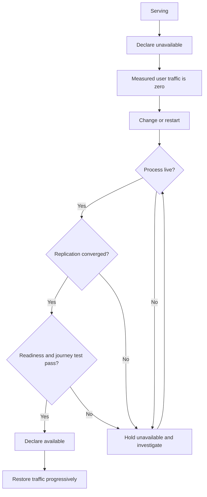

import Tabs from '@theme/Tabs';
import TabItem from '@theme/TabItem';

An HTTP response proves that a Harper node is running. Before sending user traffic to it, also check that its data is current and the application can serve the requested journey.

This guide explains the checks to use and the order for draining a node, changing it, and returning it to service.

## What You Will Learn

- Why liveness, availability, readiness, and journey verification are four signals rather than one, and which layer consumes each
- How to control node availability on Fabric or with `@harperdb/status-check` on a self-managed cluster
- How to write an application readiness route that checks only what the routed journey needs
- The order of operations for draining a node and returning it to service
- What makes a readiness endpoint safe under load, and what makes one dangerous

## Prerequisites

- A Harper cluster with at least two nodes, so draining one leaves a service behind ([Fabric](/fabric) or self-managed)
- A `super_user` credential for the Operations API
- A traffic layer you can configure health checks on: a load balancer, a CDN origin group, or a service mesh
- [How Harper Runs in Production](./how-harper-runs-in-production.mdx), and your ports written down

## Four signals, not one

| Signal                     | Where it lives                                 | What it proves                                        | Who consumes it                    |
| -------------------------- | ---------------------------------------------- | ----------------------------------------------------- | ---------------------------------- |
| Process liveness           | A trivial response on the node's HTTP endpoint | Harper is running                                     | Process supervisor, restart policy |
| Node availability flag     | `GET /status` on the application URL           | An operator or automation says this node should serve | Traffic layer health check         |
| Application readiness      | A component route on the application URL       | This node can serve this journey right now            | Traffic layer, or your own gating  |
| Critical-journey synthetic | A real request through the public route        | Users are actually being served                       | Your SLO and alerting              |

The availability flag lets an operator or automation control whether a node receives new traffic. Use it as the routing signal, and use readiness, replication checks, and journey tests to decide when to set it.

## Install the availability flag

On **Fabric**, the status component is already installed. It reads the node's `availability` record in `system.hdb_status`. Use the CLI to change that record, as described in [Load Balancing and Node Availability](/fabric/load-balancing#taking-a-node-out-of-rotation). Fabric also writes it during maintenance. Do not install the npm package below on Fabric: it serves the same `/status` path but uses a different table.

On a **self-managed cluster**, [`@harperdb/status-check`](https://github.com/HarperFast/status-check) adds a `/status` route on the application port. Deploy it with:

```json
{
	"operation": "deploy_component",
	"project": "status-check",
	"package": "@harperdb/status-check",
	"replicated": false,
	"restart": true
}
```

Repeat on each node, or declare it in each node's root `harper-config.yaml`:

```yaml
status-check:
  package: '@harperdb/status-check'
```

:::note
This entry belongs in the root `harper-config.yaml` under the Harper `rootPath`, typically `~/hdb`. An application's `config.yaml` configures its plugins and replaces the default plugin configuration. See [applications](/reference/v5/components/applications).
:::

The self-managed component provides these routes:

- `GET /status` returns `200` when the node is available, `404` when it is not
- `POST /status` marks the node available (authenticated)
- `DELETE /status` marks the node unavailable (authenticated)

Use the target node's application URL. The examples assume HTTPS is configured on that URL; a default local installation uses `http://localhost:9926`.

<Tabs>
  <TabItem value="curl" label="curl">

```bash
# Is this node advertising itself as available?
curl -s -o /dev/null -w '%{http_code}\n' https://my-node.example.com/status

# Take it out of rotation
curl -s -X DELETE https://my-node.example.com/status -u 'admin:password'

# Put it back
curl -s -X POST https://my-node.example.com/status -u 'admin:password'
```

  </TabItem>
  <TabItem value="fetch" label="fetch">

```javascript
const base = 'https://my-node.example.com/status';
const auth = { Authorization: 'Basic ' + btoa('admin:password') };

const res = await fetch(base);
console.log(res.status); // 200 available, 404 unavailable

await fetch(base, { method: 'DELETE', headers: auth }); // out of rotation
await fetch(base, { method: 'POST', headers: auth }); // back in
```

  </TabItem>
</Tabs>

Point the traffic layer's health check at `GET /status` on each node's application URL. A `404` should stop new traffic reaching that node. Existing connections may remain open, so measure the drain before restarting it.

:::note
Both implementations keep the flag node-local with `replicate: false`. Preserve that setting if you fork a component or store the flag elsewhere. A replicated flag could take every peer out of rotation when you drain one node.
:::

### A note on `set_status`

The Operations API also offers [`set_status`, `get_status`, and `clear_status`](/reference/v5/operations-api/operations#set_status--get_status--clear_status) for application-defined status values, with types for primary, maintenance, and availability.

On Fabric, `set_status` with `id=availability` controls the record its status component reads. The self-managed npm package uses its own `data.hdb_status` table, so `set_status` does not control that package. Use its `POST /status` and `DELETE /status` routes instead. Neither flag measures application health by itself.

## Write an application readiness route

Liveness and the availability flag both answer questions about the node. Readiness answers a question about the journey: if traffic arrives for this route right now, will it succeed?

Check only the dependencies needed by the journey routed to this node. A failure in an unrelated subsystem should not remove capacity from a working journey.

Add a resource to your application's `resources.js`:

```javascript
import { Resource, tables } from 'harper';

export class Readiness extends Resource {
	static async get() {
		const checks = {};

		// A bounded read against the table this journey serves.
		// Keep it to a single primary-key lookup, never a scan.
		// A missing record resolves to undefined rather than throwing,
		// so check the result as well as catching a storage fault.
		try {
			const sentinel = await tables.Product.get('readiness-probe-sentinel');
			checks.data = sentinel ? 'ok' : 'failed';
		} catch (error) {
			checks.data = 'failed';
		}

		// Only the downstream dependencies this route needs.
		try {
			const res = await fetch('https://pricing.internal.example.com/health', {
				signal: AbortSignal.timeout(500),
			});
			checks.pricing = res.ok ? 'ok' : 'failed';
		} catch (error) {
			checks.pricing = 'failed';
		}

		const ready = Object.values(checks).every((v) => v === 'ok');

		return new Response(JSON.stringify({ ready, checks, version: process.env.APP_VERSION }), {
			status: ready ? 200 : 503,
			headers: { 'Content-Type': 'application/json' },
		});
	}
}
```

The `jsResource` plugin loads the exported class. Keep it enabled if your application has an explicit `config.yaml`. At the default application mount, the route is `/Readiness`; adjust the probe URL if you configured `urlPath` or `host` routing. See [resource routing](/reference/v5/resources/overview#exporting-resources-as-endpoints) for the path rules.

:::note
Because the handler is a `static` method, it replaces Harper's built-in dispatch along with the authorization check that lives inside it, so `GET /Readiness` is unauthenticated. That is what a load balancer probe needs, and it is why the endpoint must not return anything you would not publish. Keep the response to check names and outcomes, never connection strings, credentials, or internal hostnames.

If you rewrite this as an instance `get()` instead, authorization comes back and defaults to `super_user` only, which will make your probe start failing with an authorization error rather than a readiness one. In that form you need `allowRead() { return true; }` to keep it reachable.
:::

Create the sentinel record before enabling the probe. The example assumes `Product` is exported at the server root:

```bash
curl -s -X PUT https://my-node.example.com/Product/readiness-probe-sentinel \
  -H 'Content-Type: application/json' \
  -u 'admin:password' \
  -d '{"name":"readiness probe sentinel","description":"do not delete"}'
```

If the table replicates, seed once and confirm the record reaches every node. Otherwise, seed it on each node. Keep the record in place while the probe is in use.

Bound downstream checks with a timeout. Set `APP_VERSION` in your deployment so the response identifies the component build answering during a rollout.

## Drain a node and bring it back

Keep the node unavailable until all return checks pass. On Fabric, set `availability` through the CLI as linked above; the `DELETE /status` and `POST /status` calls below are the self-managed package's controls.



<Tabs>
  <TabItem value="drain" label="Draining">

1. **Check peer capacity.** Confirm that the remaining nodes can carry the expected traffic within their capacity budget. If they cannot, postpone the change or add capacity. See [Sizing a Harper Cluster](./sizing-a-harper-cluster.mdx).
2. **Declare it unavailable.** `DELETE /status` on the target node.
3. **Verify traffic actually stopped.** Watch request volume on the target fall to zero and rise on its peers. Do not trust the configured weight; check the measured request count from [analytics](/reference/v5/analytics/overview) or your traffic layer's own metrics. Health check intervals, DNS TTLs, and client-side connection reuse all add delay here, and the delay is yours to measure.
4. **Watch the peers absorb it.** If they are going outside budget despite step 1, abort: `POST /status` to put this node back in rotation, and re-plan the change for a lower-traffic window or with added capacity.
5. **Do the work.** Restart, upgrade, reconfigure, or investigate.

  </TabItem>
  <TabItem value="return" label="Returning">

1. **Confirm the databases are current.** `cluster_status` should show the expected peer sockets connected for every database this node serves, and convergence should be complete rather than in progress.
2. **Confirm readiness passes locally.** Call your `/Readiness` route directly against the node, bypassing the traffic layer.
3. **Run the journey synthetic against the node directly.** A real read, or a safe write, through the same path a user would take.
4. **Declare it available.** `POST /status`.
5. **Hold before restoring full weight.** Give it a stability window at partial traffic and watch error rate and latency against its peers before treating it as fully back.

  </TabItem>
</Tabs>

Set the initial traffic weight before declaring the node available, where your traffic layer supports it. Increase it only while error rate and latency remain acceptable. If a return check fails, leave the node unavailable and investigate.

## Readiness hygiene

- **Keep the response cheap and bounded.** A readiness check that performs a broad scan or writes data will amplify an incident, because it runs at probe frequency across every node at exactly the moment the system is already struggling.
- **Never make it the only routing signal.** Liveness plus availability plus readiness, consumed at the right layers.
- **Probe from more than one location** where your traffic layer supports it. A single probe point cannot distinguish a network path problem from a node problem.
- **Make it observable.** Record response code, latency, the reason for a failure, and the node and component version. A readiness check whose failures you cannot explain after the fact is a check you will end up ignoring.
- **Version the contract.** If you change what readiness means, that is a change to the traffic admission policy, and it deserves the same care as a code release.

### Prove it

On a non-production cluster, restart one node under representative read and write load, using the full drain and return sequence above. Record three numbers: how long from `DELETE /status` until measured traffic on that node reaches zero, whether any user-visible errors occurred during the transition, and how long from process start until the node legitimately passed all three return gates.

Record the third number as node re-entry time, including convergence and application validation.

## Operational notes

- **A returning node is not the same as a new node.** A node whose databases have never synchronized downloads them in full. A node that was offline and comes back catches up on the transactions it missed. Both need to finish before traffic arrives, but they take very different amounts of time, so do not budget for the first when you are planning a routine restart.
- **Set unavailable before recovery work, not after.** Any operation that touches data on a node, including a restore, should happen with the node out of rotation.
- **Configuration changes need a restart to take effect**, so a node that has been reconfigured but not restarted is running the old configuration while reporting the new one. Sequence the restart into the same maintenance window.
- **Fabric routes by its status component.** It does not automatically consume your readiness route. For application-driven availability, see [Taking an Unhealthy Node Out of Rotation](../developers/taking-a-node-out-of-rotation.mdx).

## Readiness checklist

- [ ] Fabric's existing status component retained, or `@harperdb/status-check` configured on each self-managed node
- [ ] Traffic layer health check points at `GET /status` on each node's application URL
- [ ] Availability flag storage still declares `replicate: false`, if you forked the component or persist it yourself
- [ ] An application readiness route exists, scoped to one journey's dependencies
- [ ] Every downstream call in the readiness route has a timeout
- [ ] Readiness response includes the component version
- [ ] A critical-journey synthetic runs against the public route, separately from the liveness probe
- [ ] Drain sequence documented, with measured time-to-zero-traffic
- [ ] Return sequence documented, with a stability window before full weight
- [ ] Measured node re-entry time recorded, including convergence

## Additional Resources

- [`@harperdb/status-check`](https://github.com/HarperFast/status-check) component source and options
- [Operations API operations](/reference/v5/operations-api/operations) for `cluster_status`, `system_information`, and the status operations
- [Components overview](/reference/v5/components/overview) for the full list of Harper-maintained components, including the Prometheus exporter
- [Analytics overview](/reference/v5/analytics/overview) for per-node request and latency data
- [Harper Applications in Depth](../developers/harper-applications-in-depth.mdx) for custom resources and the `jsResource` plugin
- [Sizing a Harper Cluster](./sizing-a-harper-cluster.mdx) for whether your peers can absorb a drained node
