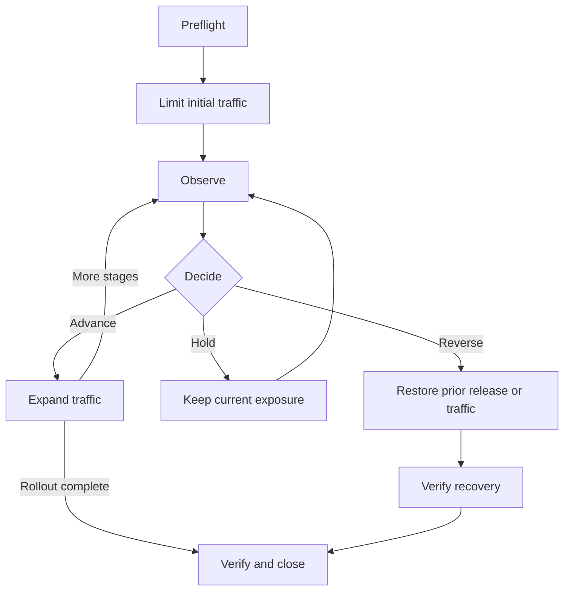

import Tabs from '@theme/Tabs';
import TabItem from '@theme/TabItem';

[Deploying from a CI/CD Pipeline](../developers/deploying-from-ci.mdx) covers installing a release from a pipeline. This guide covers limiting its initial traffic, deciding when to expand the rollout, and reversing it if checks fail.

To roll back component code, redeploy the previous immutable reference. Keep that reference addressable and rehearse the procedure before launch.

## What You Will Learn

- How to separate build, deploy, activate, and expose into four decisions with four different control points
- The change loop, and what counts as evidence at each step
- Five rollout patterns and the Harper operations behind each
- How `"restart": true` and `"restart": "rolling"` differ, and how to verify completion
- How to classify a change so you reverse the right thing, and why reversing the wrong thing can cause data loss

## Prerequisites

- A cluster of at least three nodes, so you can hold one out of rotation and still meet capacity
- A working pipeline that deploys from an immutable reference ([Deploying from a CI/CD Pipeline](../developers/deploying-from-ci.mdx))
- [Health Checks and Traffic Admission](./health-checks-and-traffic-admission.mdx), since every pattern here depends on being able to move traffic
- [Monitoring and Triage](./monitoring-and-triage.mdx), since every gate here depends on being able to compare versions

## Separate four decisions

Decide separately what to build, where to install it, which behavior to enable, and who receives it.

| Decision     | The question                              | Harper control point                                                                            |
| ------------ | ----------------------------------------- | ----------------------------------------------------------------------------------------------- |
| **Build**    | What immutable artifact exists?           | A pinned package reference, a versioned tarball, a checksum, a dependency lock                  |
| **Deploy**   | Which nodes have that artifact installed? | `deploy_component`, with `"replicated": false` to hold it to one node                           |
| **Activate** | Which code path is actually enabled?      | `urlPath` and `host` mounting, component configuration, a feature flag, a header or tenant rule |
| **Expose**   | Which production traffic reaches it?      | Traffic layer weights, the availability flag, cohort or geography targeting                     |

For example, validate a route with internal traffic before exposing it publicly. If errors rise, reduce traffic to the release or disable its feature flag while you investigate.

:::danger
**Component deployment replicates by default.** Pass `"replicated": false` when validating on one node. Other operations have different [replication defaults](/reference/v5/replication/overview#replicated-transactions); check the operation's reference before an isolated rollout.
:::

`urlPath` mounts a component at an HTTP path and `host` serves it on a virtual hostname. Routing by either has been available since v5.1.0. What arrived in v5.2.0 is declaring that routing on the application's entry in the root `harper-config.yaml`, and the matching `host` parameter on `deploy_component`. Declared that way, the routing is persisted deployment state rather than a runtime toggle. See [HTTP middleware routing](/reference/v5/http/overview#middleware-routing).

## The change loop



1. **Preflight.** Confirm the target version, component inventory, replication convergence, peer capacity with one node held out, and backups if data is at risk. Check that the prior artifact is still addressable. Name the decision owner and set stop thresholds before starting.

2. **Limit.** Start with one drained node, an internal group, selected tenants, a region, or a small traffic percentage. Choose enough requests to make the comparison meaningful.

3. **Observe.** Compare old and new versions on request success, SLO latency, worker saturation, data correctness, replication, and downstream errors. Use logs and traces to investigate differences.

4. **Decide.** Advance, hold, stop, or roll back against the agreed thresholds. Hold if required telemetry is missing.

5. **Expand.** Increase exposure only after minimum sample and hold conditions pass, and keep enough healthy capacity in the old version to reverse.

6. **Close.** Verify uniform artifact and configuration across nodes, restore intended traffic, record the actual outcome, and keep the evidence with the change record.

Record each decision and the measurements that supported it.

## Five rollout patterns

| Pattern                       | How Harper is used                                                                   | Fits when, and watch out for                                                                                      |
| ----------------------------- | ------------------------------------------------------------------------------------ | ----------------------------------------------------------------------------------------------------------------- |
| Isolated node validation      | Drain one node, deploy with `"replicated": false`, validate, re-admit a small cohort | Strongest infrastructure and component validation. Requires N+1 capacity and node targeting                       |
| Replicated rolling deployment | `deploy_component` with `"replicated": true` and `"restart": "rolling"`              | Efficient once you trust the artifact. Rolling alone is not progressive delivery, add traffic and telemetry gates |
| Feature-targeted release      | Deploy compatible code broadly, activate by flag, header, tenant, or geography       | Best when behavior can separate from code placement. Guard flag ownership and cleanup                             |
| Parallel environment          | Deploy to a separate node pool, shift traffic after validation                       | Strong isolation and fast reversal. Write ownership and replication between pools need real design                |
| Regional progression          | Promote the same artifact region by region, exposing each after local gates          | Good locality and blast radius control. One region does not predict every traffic shape                           |

Isolated node validation, concretely:

<Tabs>
  <TabItem value="isolated" label="1. Validate on one node">

```json
{
	"operation": "deploy_component",
	"project": "orders-api",
	"package": "https://artifacts.example.net/orders-api-2.4.1.tgz",
	"replicated": false,
	"restart": true
}
```

Drain the node first, deploy, run your readiness route and journey synthetic against it directly, then admit a bounded cohort.

  </TabItem>
  <TabItem value="propagate" label="2. Propagate the qualified artifact">

```json
{
	"operation": "deploy_component",
	"project": "orders-api",
	"package": "https://artifacts.example.net/orders-api-2.4.1.tgz",
	"replicated": true,
	"restart": "rolling"
}
```

On Harper Pro 5.2.15, this returns a `deployment_id` for the deployment record and a separate `restartJobId` for the rolling restart. Read each from the actual response:

```json
{
	"operation": "get_job",
	"id": "<restartJobId from the deploy response>"
}
```

Poll the node that received the deployment. `get_job` returns an array; wait for its job's `status` to be `COMPLETE`, and stop on `ERROR`. An empty array means the job was not found on that node. Retry a failed request if the node is restarting.

Use the other identifier to read the deployment details:

```json
{
	"operation": "get_deployment",
	"deployment_id": "<deployment_id from the deploy response>"
}
```

On 5.2, check its `status` and `peer_results` for install and replication failures, then confirm the serving version directly on every node. Later releases change how the rolling job applies the release; use the version-specific [CI wait procedure](../developers/deploying-from-ci.mdx#path-a-deploy-a-tagged-release-from-your-repository) with your installed version.

  </TabItem>
</Tabs>

Prefer a pinned version or an immutable tarball over a moving branch reference. A branch moves, so you can neither audit what was running yesterday nor redeploy it.

:::tip
A pinned registry version such as `@my-org/orders-api@2.4.1` is the best-travelled form. If you pin a tarball URL instead, note that a bare `https://` URL pointing at `github.com`, `gitlab.com`, or `bitbucket.org` is treated as a git clone rather than a download, so a GitHub release asset URL will not behave the way the example above does. Host release tarballs somewhere neutral, or use a registry version.
:::

## What restart actually does

On Harper 5.2, the two modes behave as follows:

**`"restart": true`** starts a restart of the HTTP worker threads on the node handling the call and returns immediately, without waiting for it. A `200` means the deploy succeeded and a restart has been requested. It does not mean the new code is serving yet. Until a worker has been replaced it is still running the previous code, and on platforms where replacements share a listening port it keeps accepting connections during the changeover.

**`"restart": "rolling"`** starts a replicated `restart_service` job. Poll its `restartJobId` with [`get_job`](/reference/v5/operations-api/operations#get_job). It sequences node restarts, but your peers still need enough capacity and your traffic-admission checks must pass.

:::warning
**Use `"rolling"` for cluster rollouts.** With `"restart": true`, each node restarts independently as it applies the replicated deployment. Those restarts can overlap and reduce serving capacity. Use `"restart": true` for the drained single-node validation above, or for a development instance.
:::

Wait for the rolling job and verify the serving version on each node. A successful deployment record alone does not establish that every worker is running the release.

### Waiting for the restart

<VersionBadge type="changed" version="v5.3.0" />

From v5.3.0, `"restart": true` waits for the worker restart to finish before responding, rather than returning as soon as it has been requested. The wait follows the restart's own progress rather than a fixed timeout, so the call can take tens of seconds on a slow install with many worker threads, with a hard ceiling of ten minutes.

A caller timeout does not stop the restart. On v5.3, the deploy response does not report restart success; check the logs for restart failures and verify the serving version through readiness or a journey test. For later versions, check the [restart and certification behavior](/reference/v5/operations-api/operations#restarting-restart) before choosing pipeline checks.

Set these parameters to match your payload size, network, and failure policy:

- `deployment_timeout` <VersionBadge version="v5.1.4" /> is how long a peer waits for the replicated payload before failing, defaulting to 120000 ms. Raise it for large components or slow links.
- `ignore_replication_errors` <VersionBadge version="v5.1.4" /> treats a peer that fails to receive the deploy as non-fatal. By default a failed peer makes the whole operation return a non-2xx status, while the component is still deployed on the origin node. Decide which behavior you want before you need it.

## Configuration changes are deployments too

Apply the same review, rollout, and rollback checks to configuration changes.

`set_configuration` supports `"replicated": true` <VersionBadge version="v5.2.0" /> to apply a change across the cluster in one call, with per-node outcomes in the response. For settings that apply on worker restart, follow with `restart_service` using `"replicated": true`, which restarts workers on each node in turn.

Check the setting's restart requirements first. Process-level settings such as [`threads.v8Flags`](/reference/v5/configuration/options#applying-v8-flags) require a full process restart; `restart_service` does not apply them. Drain and restart each node in turn, using `restart` or your process/container manager, and verify it before advancing. The `restart` operation does not replicate.

```json
{
	"operation": "set_configuration",
	"logging_level": "info",
	"replicated": true
}
```

:::danger
Only replicate cluster-appropriate parameters. Node-local values such as ports, `node.hostname`, file paths, TLS material, and `replication.hostname`, `url`, or `routes` would overwrite every peer's own values. Replicating one of these is a cluster-wide outage delivered in a single API call.
:::

`get_status.restartRequired` tracks component and code restarts, so it does not identify pending `set_configuration` changes. Record those changes yourself, use the required restart type, and read back `get_configuration`. Read-back confirms the configured value; verify the running behavior too.

## Rollback is a designed capability

Classify the change before choosing a reversal path, because these have different compatibility requirements, different authorities, and very different blast radii:

| Change type            | Reversal                                          | Watch out for                                                       |
| ---------------------- | ------------------------------------------------- | ------------------------------------------------------------------- |
| Component release      | Deploy the previous immutable reference           | The previous artifact must still be addressable                     |
| Feature behavior       | Deactivate the flag, no deploy needed             | Fastest reversal available. Requires the flag to have been built in |
| Traffic exposure       | Restore prior weights or set the node unavailable | Fastest containment. Does not undo anything already written         |
| Configuration          | `set_configuration` back, then restart            | Needs a restart, so it is not instant                               |
| Harper runtime version | Version-specific procedure                        | Mixed versions change replication and deploy behavior               |
| Schema or data         | Forward repair or restore                         | See the warning below                                               |

Practices that make each of these real:

- **Keep the previous package addressable and rehearse redeploying it** before launch, not during an incident.
- **Prefer activating a retained release on v5.3.0 and later.** <VersionBadge version="v5.3.0" /> Use `deploy_component` with the previous `deployment_id` and the appropriate restart mode to restore its installed bytes without resolving or installing again. Verify that every target node still retains it: `deployment.stagingRetention.maxCount` can prune replaced releases. See [going back to a previous release](/reference/v5/operations-api/operations#going-back-to-a-previous-release).
- **Prefer expand-then-contract schema evolution.** Add the new shape, migrate, then remove the old shape in a separate change. Destructive schema behavior is operation and version dependent, so each destructive change needs an exact written procedure and verification on every node.
- **Use the same gates for rollback as for forward movement.** Availability, journey synthetic, peer stability, data validation, traffic reconciliation. A rollback is a deployment and can fail like one.

:::warning
If a release changed the meaning of persisted data, code rollback alone will not fix it, and restoring a database to undo application code is usually the wrong move. A restore rolls back every write in the window, including all the valid ones, so it can violate your RPO in order to fix a code bug. Define forward repair or replay for these cases instead. See [Backup and Recovery](./backup-and-recovery.mdx).
:::

### Prove it

Rehearse a stopped rollout end to end on a non-production cluster:

1. Declare a threshold before you start, for example "stop if journey success on the new cohort is more than 0.5 percent below the control cohort over five minutes."
2. Deploy a component that fails that threshold deliberately, to a bounded cohort.
3. Detect it through your dashboards rather than because you know what you did.
4. Reverse it, and record both the time from the reversal decision to verified service and the total time from failure to verified service. Compare the total, including detection and decision time, with your RTO.
5. Verify uniform state afterwards: `get_components` on every node, and `list_deployments` showing the reversal.

Check every node after rollback; a cluster average can hide nodes still running the failed release.

## Operational notes

- **Version parity is an operating requirement.** Mixed Harper versions in a cluster change replication and deployment behavior, so a rollout that stalls halfway is a state you want to detect and exit, not sit in.
- **Keep deploy credentials in your delivery platform's secret store**, use TLS and least privilege, and retain the operation result as change evidence. See [secrets](/reference/v5/security/secrets).
- **Component deployment can replicate, so a deploy is a cluster event.** Keep isolated single-node deployment available for validation, because if the only deployment path you have is replicated then you have no way to test anything on one node.
- **Flag cleanup is part of the release.** A feature flag with no owner and no removal date becomes permanent configuration that nobody understands, and it will eventually be the thing nobody can explain during an incident.
- **Record who decided, not only what happened.** Named decision authority is what makes a stop gate function under pressure, and it costs nothing to write down in advance.

## Readiness checklist

- [ ] Artifacts are immutable and referenced by pinned version, never by branch
- [ ] Deploy and expose are separate actions in your pipeline
- [ ] The previous known-good artifact is addressable, and redeploying it has been rehearsed
- [ ] On v5.3.0 and later, the previous `deployment_id` is still retained on every target node and activation has been rehearsed
- [ ] Cohort ladder defined, from smallest useful sample to full exposure
- [ ] Stop thresholds and hold times declared before the rollout starts
- [ ] A named decision owner for advance, hold, stop, and roll back
- [ ] Pipeline polls the restart job rather than treating the deploy response as proof the new code is serving
- [ ] `"replicated": false` used deliberately wherever a change is meant to reach one node only, since replication is the default
- [ ] Cluster deploys use `"restart": "rolling"`, not `"restart": true`
- [ ] `deployment_timeout` and `ignore_replication_errors` set deliberately
- [ ] Configuration changes go through the same change record as code
- [ ] `get_configuration` read back after every configuration change
- [ ] Schema changes follow expand-then-contract, with destructive operations documented per node
- [ ] Forward repair defined for changes that alter persisted meaning
- [ ] Reversal duration and total recovery time recorded from a rehearsal, with the total compared against RTO

## Additional Resources

- [Deploying from a CI/CD Pipeline](../developers/deploying-from-ci.mdx) for the pipeline mechanics and deploy credentials
- [`deploy_component` reference](/reference/v5/operations-api/operations#deploy_component) for every parameter including `urlPath`, `host`, and replication controls
- [Applications reference](/reference/v5/components/applications) for component structure and the full component operation set
- [Deployment records](/reference/v5/operations-api/operations#deployment-operations) for `list_deployments` and `get_deployment`
- [HTTP middleware routing](/reference/v5/http/overview#middleware-routing) for `urlPath` and `host` activation
- [Configuration operations](/reference/v5/configuration/operations) for `set_configuration` and restart requirements
- [Database schema](/reference/v5/database/schema) for schema evolution
- [Multiple Applications on One Cluster](../developers/multiple-applications.mdx) for running more than one component side by side
