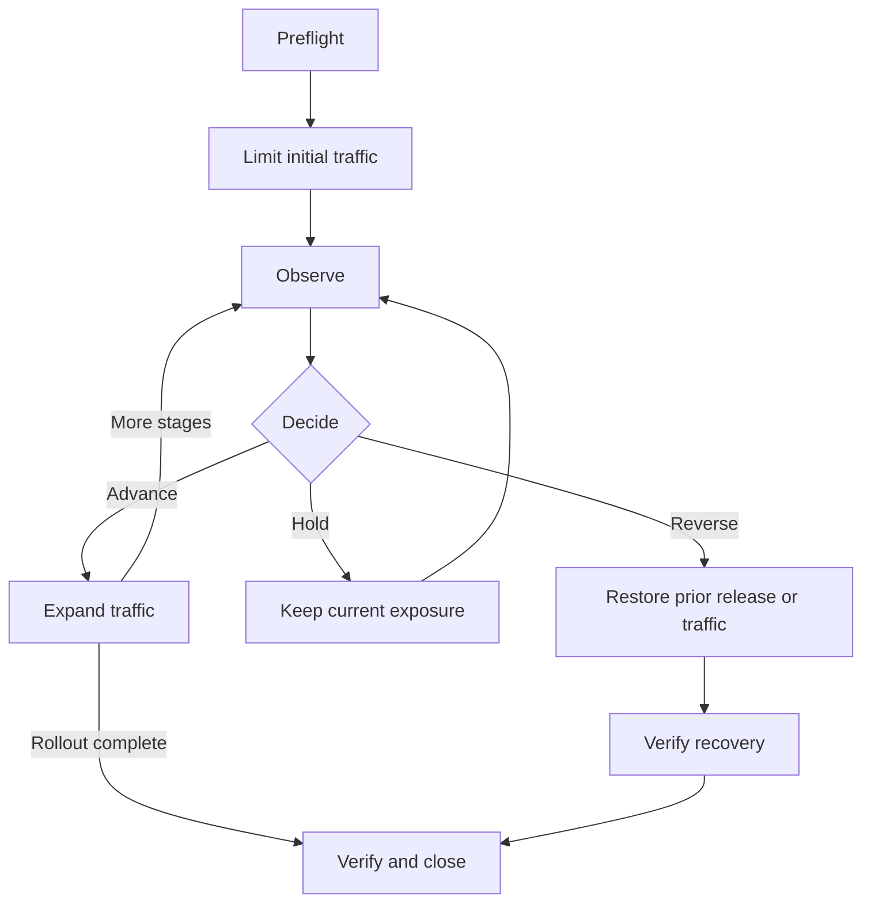

import Tabs from '@theme/Tabs';
import TabItem from '@theme/TabItem';

This guide deploys a Harper application to a cluster, waits until every node runs it, and rolls it back. It then covers limiting a release's first traffic and deciding when to expand or reverse it. The commands use the Harper CLI and match projects created with `npm create harper@latest`. [Deploying from a CI/CD Pipeline](../developers/deploying-from-ci.mdx) covers pipeline authentication, private sources, and registry artifacts in more depth.

## What You Will Learn

- How to deploy a Harper backend, or a frontend built once, from your machine or from GitHub Actions
- What `restart=rolling` does and does not do, and how to wait for it
- How to roll back from the CLI or from Studio
- How to limit a release's first traffic, and decide when to advance, hold, or reverse
- How to classify a change so you reverse the right thing, and why reversing the wrong thing can cause data loss

## Prerequisites

- A Harper Fabric cluster, or a self-managed Harper Pro cluster. Rolling back to a kept release needs v5.3.0 or later.
- The Harper CLI on your machine: `npm install -g harper`
- An application, for example one created with `npm create harper@latest`
- [Health Checks and Traffic Admission](./health-checks-and-traffic-admission.mdx), for taking a node out of rotation
- [Monitoring and Triage](./monitoring-and-triage.mdx), for comparing versions during a rollout

## Deploy a release

### Log in

Set the cluster's Operations API URL once per shell, then log in with the cluster's admin username and password:

```bash
export HARPER_CLI_TARGET=https://my-cluster.example.com:9925
harper login "$HARPER_CLI_TARGET"
```

The CLI saves a token for that URL. Later `harper` commands in the shell use `HARPER_CLI_TARGET` as their target.

### A Harper backend

An application that runs from source, such as a `create-harper` project without a frontend build, deploys straight from its directory:

```bash
cd my-app
harper deploy project=my-app restart=rolling json=true > deploy.json
```

`create-harper` projects run the same deploy, without `json=true`, as `npm run deploy`. The CLI packages the directory and uploads it, and Harper installs its dependencies. On Fabric and Harper Pro, a deploy reaches every node unless you pass `replicated=false`.

The upload includes everything in the directory except `node_modules`, including `.git` and any `.env` file. Deploy from a clean checkout, or stage only the files you want to ship, as the next section does.

### A frontend built once

The React and Vue templates load the `@harperfast/vite` plugin, which builds the frontend on each node when the build output is missing, so every node also carries the build toolchain. To build once and ship only the output, keep a second configuration file for the release. Copy your `config.yaml` to `deploy.config.yaml`, keep its `rest`, `graphqlSchema`, `jsResource`, and [`static`](/reference/v5/static-files/overview) entries as they are, and remove the `@harperfast/vite` and `@harperfast/schema-codegen` entries, which load packages the release does not install. For the JavaScript React template, that leaves:

```yaml
# deploy.config.yaml
rest: true
graphqlSchema:
  files: 'schemas/*.graphql'
jsResource:
  files: 'resources/*.js' # the TypeScript templates use 'resources/*.ts'
static:
  files: 'dist/**'
```

Build, copy the release into its own directory, and deploy that directory:

```bash
npm ci
npm run build
rm -rf deploy && mkdir deploy
cp -R dist schemas resources deploy/
cp deploy.config.yaml deploy/config.yaml
(cd deploy && harper deploy project=my-app restart=rolling json=true) > deploy.json
```

The staged directory has no `package.json`, so the nodes skip the install step. If your resources import npm packages, add a `package.json` to `deploy/` that lists only those runtime dependencies. Harper Studio [deploys itself this way](https://github.com/HarperFast/studio/blob/stage/.github/actions/studio-deploy/action.yaml).

### Wait for every node

With `restart=rolling`, the deploy returns once the node you called has the release. The other nodes take it in a job that keeps running afterwards. Poll it until it prints `COMPLETE`:

```bash
harper get_job id="$(jq -r '.restartJobId' deploy.json)" json=true | jq -r '.[0].status'
```

`ERROR` means the rollout failed, and `harper get_job` without the `jq` filter shows the job's `message`. `null` means the node that answered does not have the job: Harper does not replicate jobs, so poll the node that received the deploy. See [the job lives on one node](../developers/deploying-from-ci.mdx#path-a-deploy-a-tagged-release-from-your-repository). When the job completes, check the serving version on every node through your readiness route or a journey test.

### Deploy from GitHub Actions

`create-harper` projects include `.github/workflows/deploy.yaml`. It tests every pull request and, when a change merges to `main`, deploys with `restart=rolling` and waits for the job. It authenticates with GitHub's OIDC token, so the repository stores no Harper credential. Set up the cluster side once from your machine, logged in as a `super_user`:

```bash
npm run deploy:setup-ci
```

<VersionBadge version="v5.4.0" />

The script runs [`harper deploy setup=true provider=github-actions`](/reference/v5/cli/commands#github-actions-deploys-oidc). It creates a deploy-only user and a trust policy pinned to `main` and the `production` environment, and sets the repository's `HARPER_CLI_TARGET` variable. With an earlier CLI, create the user and policy by hand, as [Let the workflow authenticate with OIDC](../developers/deploying-from-ci.mdx#let-the-workflow-authenticate-with-oidc) describes, pinning `workflow_ref` to `main`. Trust policies need a v5.3.0 or later cluster.

For a frontend built once, replace the template's workflow with one that builds in one job and deploys in another:

```yaml
# .github/workflows/deploy.yaml
name: Deploy to Harper
on:
  push:
    branches: [main]

permissions:
  contents: read

concurrency:
  group: deploy-${{ github.ref }}

jobs:
  build:
    runs-on: ubuntu-latest
    steps:
      - uses: actions/checkout@v4
        with:
          persist-credentials: false
      - uses: actions/setup-node@v4
        with:
          node-version: 22
      - run: npm ci
      - run: npm test
      - run: npm run build
      - name: Stage the release
        run: |
          mkdir deploy
          cp -R dist schemas resources deploy/
          cp deploy.config.yaml deploy/config.yaml
      - uses: actions/upload-artifact@v4
        with:
          name: release
          path: deploy/

  deploy:
    needs: build
    runs-on: ubuntu-latest
    environment: production
    permissions:
      id-token: write
    env:
      HARPER_CLI_TARGET: ${{ vars.HARPER_CLI_TARGET }}
    steps:
      - uses: actions/download-artifact@v4
        with:
          name: release
          path: deploy
      - uses: actions/setup-node@v4
        with:
          node-version: 22
      - run: npm install --global harper@^5.3
      - name: Deploy the release
        working-directory: deploy
        run: harper deploy project=my-app restart=rolling json=true > "$RUNNER_TEMP/deploy.json"
      - name: Wait for every node to take the release
        run: |
          JOB_ID=$(jq -r '.restartJobId // empty' "$RUNNER_TEMP/deploy.json")
          [ -n "$JOB_ID" ] || { echo "The rolling deploy returned no restartJobId"; exit 1; }
          LAST="could not be read"
          for attempt in $(seq 60); do
            sleep 10
            harper get_job id="$JOB_ID" json=true > "$RUNNER_TEMP/job.json" || continue
            case $(jq -r '.[0].status // "MISSING"' "$RUNNER_TEMP/job.json") in
              COMPLETE) exit 0 ;;
              ERROR) jq -r '.[0].message' "$RUNNER_TEMP/job.json"; exit 1 ;;
              MISSING) LAST="was not on the node that answered; its outcome is unknown" ;;
              *) LAST="was still running" ;;
            esac
          done
          echo "After 60 polls, job $JOB_ID $LAST"
          exit 1
```

The `build` job runs your dependencies' install scripts and build tools, and cannot request an identity token. The `deploy` job can, and it runs none of your repository's code: it installs only the Harper CLI and uploads the built release. [Path B](../developers/deploying-from-ci.mdx#path-b-build-in-ci-publish-to-github-packages-deploy-the-artifact) explains this split, and publishes the build to a registry instead, which gives the release a version you can redeploy from any machine.

## What `restart=rolling` does

`restart=rolling` restarts the node you called, then each other node in turn. It waits for one node's restart to finish before it starts the next, and returns a `restartJobId` to poll. It does not:

- **Take a node out of rotation.** Each node keeps taking traffic while its workers are replaced a few at a time. Harper does not mark the node unavailable or drain its connections. [harper#2975](https://github.com/HarperFast/harper/issues/2975) tracks load-balancer-aware rolling deploys.
- **Run your checks between nodes.** It moves on when a node's restart finishes, not when your readiness route or journey tests pass. From v5.4.0, [canary certification](/reference/v5/operations-api/operations#certifying-a-release-in-a-canary-worker) rejects a release that fails to load, but it does not run your checks.
- **Prove that every node restarted.** Without canary certification (before v5.4.0, or when the deploy's `certification` is `unavailable`), the job records an error for a node it cannot reach and continues to the next one. A `COMPLETE` job can still leave a node on the old release.

To keep traffic off a node while it changes, drain it first, as in [isolated node validation](#limit-a-releases-first-traffic) or the [drain and return sequence](./health-checks-and-traffic-admission.mdx#drain-a-node-and-bring-it-back).

`restart=true` restarts each node as it applies the replicated deploy, so restarts can overlap and reduce serving capacity. Use it for one drained node, a single-node instance, or development. On v5.2, it returns as soon as the restart is requested. <VersionBadge type="changed" version="v5.3.0" /> From v5.3.0, it waits for the restart on the node you called, up to ten minutes. A caller timeout does not stop the restart, and the response does not report restart success, so check the serving version. For later versions, see [restart and certification behavior](/reference/v5/operations-api/operations#restarting-restart).

Two deploy parameters control replication failures:

- `deployment_timeout` <VersionBadge version="v5.1.4" /> is how long a peer waits for the replicated payload before failing, defaulting to 120000 ms. Raise it for large components or slow links.
- `ignore_replication_errors` <VersionBadge version="v5.1.4" /> treats a peer that fails to receive the deploy as non-fatal. By default a failed peer makes the whole operation return a non-2xx status, while the component is still deployed on the origin node. Decide which behavior you want before you need it.

## Roll back

### From the CLI

<VersionBadge version="v5.3.0" />

When a deploy replaces a release, each node keeps the replaced one under its `deployment_id`. List recent releases, newest first:

```bash
harper list_deployments project=my-app status=success limit=5 json=true \
  | jq -r '.deployments[] | "\(.deployment_id)  \(.started_at / 1000 | floor | todate)"'
```

Activate the release you want back:

```bash
harper deploy project=my-app deployment_id=<deployment_id> restart=rolling json=true > deploy.json
```

Nothing is rebuilt or reinstalled. Wait for the job and check every node, as for any rolling deploy. A node that no longer keeps the release refuses it: [`deployment.stagingRetention.maxCount`](/reference/v5/configuration/options#deployment) sets how many replaced releases each node keeps, defaulting to `5`. See [going back to a previous release](/reference/v5/operations-api/operations#going-back-to-a-previous-release) for which releases are kept.

Before v5.3.0, or when no node keeps the release, deploy the previous release again: check out its commit and repeat the deploy, or pass the previous version as `package`.

### From Studio

<VersionBadge version="v5.3.0" />

In [Harper Studio](/reference/v5/studio/overview), open the cluster and go to **Config > Deployments**. Open the release you want back and choose **Roll back to this release**. Studio activates it on every node, one at a time, and shows the rollout's progress. Check the serving version on every node afterwards.

## Limit a release's first traffic

A rolling deploy changes every node. To test a release on part of your traffic first, separate installing it from exposing it, and decide at each step whether to expand.



1. **Preflight.** Confirm the target version, component inventory, replication convergence, peer capacity with one node held out, and backups if data is at risk. Check that the prior release can still be activated or redeployed. Name the decision owner and set stop thresholds before starting.
2. **Limit.** Start with one drained node, an internal group, selected tenants, a region, or a small traffic percentage. Choose enough requests to make the comparison meaningful.
3. **Observe.** Compare old and new versions on request success, SLO latency, worker saturation, data correctness, replication, and downstream errors.
4. **Decide.** Advance, hold, or roll back against the agreed thresholds. Hold if required telemetry is missing.
5. **Expand.** Increase exposure only after minimum sample and hold conditions pass, and keep enough healthy capacity on the old version to reverse.
6. **Close.** Verify the same release and configuration on every node, restore intended traffic, and record the outcome with the measurements that supported each decision.

| Pattern                       | How Harper is used                                                         | Fits when, and watch out for                                                                               |
| ----------------------------- | -------------------------------------------------------------------------- | ---------------------------------------------------------------------------------------------------------- |
| Isolated node validation      | Drain one node, deploy with `replicated=false`, validate, re-admit a group | Strongest validation before any user sees the release. Needs spare capacity and a direct URL for each node |
| Replicated rolling deployment | `harper deploy` with `restart=rolling`                                     | Simple once you trust the release. Each node stays in rotation while it restarts                           |
| Feature-targeted release      | Deploy compatible code broadly, enable it by flag, header, or tenant       | Best when behavior can be separated from deployment. Assign an owner and a removal date to each flag       |
| Parallel environment          | Deploy to a separate node pool, shift traffic after validation             | Strong isolation and fast reversal. Write ownership and replication between pools need real design         |
| Regional progression          | Deploy the same release region by region, exposing each after its checks   | Limits the blast radius. One region does not predict every traffic shape                                   |

Isolated node validation needs at least three nodes, so the others can carry the traffic of the node you hold out. Take one node out of rotation with the [drain sequence](./health-checks-and-traffic-admission.mdx#drain-a-node-and-bring-it-back), log in to its own URL, and deploy to it alone:

<Tabs>
  <TabItem value="isolated" label="1. Validate on one node">

```bash
harper login https://node-a.example.com:9925
harper deploy project=orders-api package=@my-org/orders-api@2.4.1 \
  replicated=false restart=true target=https://node-a.example.com:9925
```

Run your readiness route and journey tests against that node directly, then admit a small group of users to it.

  </TabItem>
  <TabItem value="propagate" label="2. Deploy to the rest">

```bash
harper deploy project=orders-api package=@my-org/orders-api@2.4.1 \
  restart=rolling json=true > deploy.json
```

[Wait for the job](#wait-for-every-node), then check every node. On Harper Pro 5.2, also read `harper get_deployment deployment_id="$(jq -r .deployment_id deploy.json)"` and check its `status` and `peer_results` for install and replication failures.

  </TabItem>
</Tabs>

Deploy a pinned version or commit rather than a moving branch, so you can tell what ran yesterday and deploy it again. A private registry needs a [`credentials`](../developers/deploying-from-ci.mdx#give-harper-a-durable-credential-for-a-private-source) reference.

:::danger
**Component deployment replicates by default.** Pass `replicated=false` when validating on one node. Other operations have different [replication defaults](/reference/v5/replication/overview#replicated-transactions); check the operation's reference before an isolated rollout.
:::

To activate a release for part of your traffic without a second deploy, mount it at a path or hostname. `urlPath` mounts a component at an HTTP path and `host` serves it on a virtual hostname. Routing by either has been available since v5.1.0. What arrived in v5.2.0 is declaring that routing on the application's entry in the root `harper-config.yaml`, and the matching `host` parameter on `deploy_component`. Declared that way, the routing is persisted deployment state rather than a runtime toggle. See [HTTP middleware routing](/reference/v5/http/overview#middleware-routing).

## Configuration changes are deployments too

Apply the same review, rollout, and rollback checks to configuration changes.

`set_configuration` supports `replicated=true` <VersionBadge version="v5.2.0" /> to apply a change across the cluster in one call, with per-node outcomes in the response. For settings that apply on worker restart, follow with `restart_service`, which restarts workers on each node in turn:

```bash
harper set_configuration logging_level=info replicated=true
harper restart_service service=http replicated=true
```

Check the setting's restart requirements first. Process-level settings such as [`threads.v8Flags`](/reference/v5/configuration/options#applying-v8-flags) <VersionBadge version="v5.4.0" /> require a full process restart; `restart_service` does not apply them. Drain and restart each node in turn, using the `restart` operation or your process or container manager, and verify it before advancing. The `restart` operation does not replicate.

:::danger
Only replicate cluster-appropriate parameters. Node-local values such as ports, `node.hostname`, file paths, TLS material, and `replication.hostname`, `url`, or `routes` would overwrite every peer's own values. Replicating one of these is a cluster-wide outage delivered in a single API call.
:::

`get_status.restartRequired` tracks component and code restarts, so it does not identify pending `set_configuration` changes. Record those changes yourself, use the required restart type, and read back `harper get_configuration`. Read-back confirms the configured value; verify the running behavior too.

## Classify the change before reversing it

Different changes need different reversal paths, with different compatibility requirements and blast radii:

| Change type            | Reversal                                              | Watch out for                                                       |
| ---------------------- | ----------------------------------------------------- | ------------------------------------------------------------------- |
| Component release      | Activate the previous `deployment_id`, or redeploy it | Each node must still keep the release, or the artifact must exist   |
| Feature behavior       | Turn the flag off, no deploy needed                   | Fastest reversal available. Requires the flag to have been built in |
| Traffic exposure       | Restore prior weights or set the node unavailable     | Fastest containment. Does not undo anything already written         |
| Configuration          | `set_configuration` back, then restart                | Needs a restart, so it is not instant                               |
| Harper runtime version | Version-specific procedure                            | Mixed versions change replication and deploy behavior               |
| Schema or data         | Forward repair or restore                             | See the warning below                                               |

- **Rehearse rolling back before launch**, not during an incident.
- **Prefer expand-then-contract schema evolution.** Add the new shape, migrate, then remove the old shape in a separate change. Destructive schema behavior depends on the operation and version, so each destructive change needs an exact written procedure and verification on every node.
- **Use the same checks for rollback as for forward movement**: availability, journey tests, peer stability, data validation, and traffic. A rollback is a deployment and can fail like one.

:::warning
If a release changed the meaning of persisted data, code rollback alone will not fix it, and restoring a database to undo application code is usually the wrong move. A restore rolls back every write in the window, including all the valid ones, so it can violate your RPO in order to fix a code bug. Define forward repair or replay for these cases instead. See [Backup and Recovery](./backup-and-recovery.mdx).
:::

### Prove it

Rehearse a stopped rollout end to end on a non-production cluster:

1. Declare a threshold before you start, for example "stop if journey success on the new group is more than 0.5 percent below the control group over five minutes."
2. Deploy a release that fails that threshold deliberately, to a limited group.
3. Detect it through your dashboards rather than because you know what you did.
4. Roll it back, and record both the time from the decision to verified service and the total time from failure to verified service. Compare the total, including detection and decision time, with your RTO.
5. Verify every node afterwards: `harper get_components` against each node's URL, and `harper list_deployments project=<name>` showing the rollback.

## Operational notes

- **Keep Harper versions the same on every node.** Mixed versions change replication and deployment behavior, so detect and finish a rollout that stalls halfway.
- **Keep deploy credentials in your delivery platform's secret store**, or use the OIDC setup above so there is none. Use TLS and least privilege, and keep the deploy result as change evidence. See [secrets](/reference/v5/security/secrets).
- **Keep a single-node deployment path.** Every deploy replicates by default, so without `replicated=false` and a direct node URL you cannot test anything on one node.

## Readiness checklist

- [ ] Each release is a pinned version, a commit, or a staged build, never a moving branch
- [ ] The rollback path is rehearsed: on v5.3.0 and later the previous `deployment_id` is kept on every node; otherwise the previous artifact is still available
- [ ] Deploy and expose are separate steps for changes that need a limited first audience
- [ ] Cohort ladder defined, from smallest useful sample to full exposure
- [ ] Stop thresholds and hold times declared before the rollout starts
- [ ] A named decision owner for advance, hold, and roll back
- [ ] Pipeline waits for the rolling job, then checks the serving version on every node
- [ ] Nodes that must not serve while they change are drained first, since `restart=rolling` keeps each node in rotation
- [ ] `replicated=false` used deliberately wherever a change is meant to reach one node only, since replication is the default
- [ ] Cluster deploys use `restart=rolling`, not `restart=true`
- [ ] `deployment_timeout` and `ignore_replication_errors` set deliberately
- [ ] Configuration changes go through the same change record as code, and `get_configuration` is read back after each one
- [ ] Schema changes follow expand-then-contract, with destructive operations documented per node
- [ ] Forward repair defined for changes that alter persisted meaning
- [ ] Rollback duration and total recovery time recorded from a rehearsal, with the total compared against RTO

## Additional Resources

- [Deploying from a CI/CD Pipeline](../developers/deploying-from-ci.mdx) for OIDC setup, private sources, and registry artifacts
- [`harper deploy`](/reference/v5/cli/commands#harper-deploy) for every CLI deploy parameter
- [`deploy_component` reference](/reference/v5/operations-api/operations#deploy_component) for the server-side behavior, including `urlPath`, `host`, and replication controls
- [Deployment records](/reference/v5/operations-api/operations#deployment-operations) for `list_deployments` and `get_deployment`
- [Static files](/reference/v5/static-files/overview) for serving a built frontend
- [HTTP middleware routing](/reference/v5/http/overview#middleware-routing) for `urlPath` and `host` activation
- [Configuration operations](/reference/v5/configuration/operations) for `set_configuration` and restart requirements
- [Database schema](/reference/v5/database/schema) for schema evolution
- [Multiple Applications on One Cluster](../developers/multiple-applications.mdx) for running more than one component side by side
